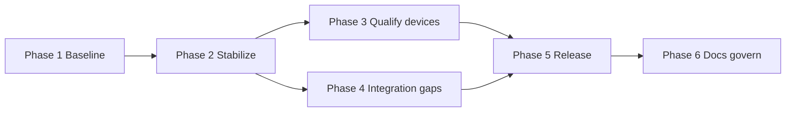

# Airo / Aika Stream — execution plan

**Last verified:** 2026-10-16 · Base SHA **`6e86787985490a6b1c4a86eb801c3334b4bc8bcd`** (`origin/main`, includes #2112 project pack).

Execute phases **in order**. Do not promote Play or Amazon builds until Phase 3 sign-offs exist for the target artifact SHA.

Status vocabulary: Done, Pending, Blocked, Deferred, Needs verification.

---

## Phase 1 — Baseline (inventory)

**Goal:** Single SSOT snapshot for branches, versions, releases, and open work.

| Step | Action | Status | Evidence |
| --- | --- | --- | --- |
| 1.1 | Record `main` HEAD SHA | **Done** | `6e86787985490a6b1c4a86eb801c3334b4bc8bcd` |
| 1.2 | Record pubspec versions (phone, TV, coins) | **Done** | `app/pubspec.yaml` `0.1.0+13`; `app/pubspec_tv.yaml` `0.0.4+28`; `app/pubspec_coins.yaml` `0.0.7+12` |
| 1.3 | List latest GitHub releases/tags | **Done** | `aika-stream-v0.0.2` (latest product release); `v0.0.6` aggregate |
| 1.4 | Enumerate open PRs | **Done** | #2111, #2110, #2109 (Dependabot only) |
| 1.5 | Map active remote branches to tracks | **Done** | See `PROJECT_STATUS.md` §1; IPTV `agent/iptv/aika-stream-*`, Fire `cursor/fire-tv-build-pipeline-ff46` (merged) |
| 1.6 | Confirm TV Android application id | **Done** | `com.developerscoffee.tv.midas` — `app/android/app/build.gradle.kts` |

**Exit criteria:** `PROJECT_STATUS.md` baseline table complete — **Done**.

---

## Phase 2 — Stabilize (build & CI)

**Goal:** Prove `main` compiles and tests pass for app, TV, and Fire TV variants.

| Step | Action | Status | Evidence / command |
| --- | --- | --- | --- |
| 2.1 | CI Continuous Integration on latest `main` push | **Done** | [38715870317](https://github.com/DevelopersCoffee/airo/actions/runs/38715870317) — all listed jobs success on pack SHA |
| 2.2 | Local `flutter analyze` (phone app) | **Blocked** | Flutter SDK unavailable on Cloud Agent VM; run on host: `cd app && flutter analyze --no-fatal-infos --no-fatal-warnings` |
| 2.3 | Local `packages/feature_iptv` tests | **Blocked** | Host: `cd packages/feature_iptv && flutter test` |
| 2.4 | Local TV shell tests | **Blocked** | Host: `cd app && flutter test test/core/app/tv_shell_test.dart` |
| 2.5 | PR validation script bundle (non-Dart) | **Done** (for docs-only PR) | `scripts/check-docs-completeness.sh --base origin/main --head HEAD` |
| 2.6 | Web release sanity (when touching native paths) | **Needs verification** | Not run this pass; policy: `cd app && flutter build web --release` |

**Exit criteria:** CI green **Done**; host-local analyze/tests **Needs verification** on developer machine.

---

## Phase 3 — Qualify devices

**Goal:** Physical-device evidence for playback, D-pad, memory, and long-run stability — or explicit **Needs verification** with rerun script.

| Step | Action | Status | Rerun steps |
| --- | --- | --- | --- |
| 3.1 | Import Jul 2026 Pixel 9 evidence | **Needs verification** | Read `docs/release/evidence/AIRO_TV_V0.0.5_PIXEL9_QA.md`; rebuild/install current target APK; repeat import/search/playback/PiP; logcat for native libs |
| 3.2 | Import Fire TV Stick Jul 2026 campaign | **Needs verification** | Read `docs/release/evidence/airo-tv-physical-device-qa-2026-07-27.md`; set 720p; physical remote; capture screenshots under `docs/release/evidence/assets/` |
| 3.3 | D-pad stick evidence | **Needs verification** | `docs/release/evidence/airo-tv-dpad-fire-tv-stick-3rd-gen-2026-07-27.md` |
| 3.4 | Automated test plan from TV+19 notes | **Needs verification** | `flutter test` commands in gstack test plan (Sept 2026); extend coverage for Watch pop, transport row, mini guide |
| 3.5 | Long playback / memory | **Needs verification** | 2h live stream; record peak RSS; file new evidence md |
| 3.6 | Post–#2100 Fire TV on-device smoke | **Needs verification** | Install CI fire-tv artifact from run 38715870317; cold start, playlist import, playback 15min |

**Exit criteria:** New evidence md per target release SHA, or explicit waiver in release checklist.

**Cloud Agent constraint:** Steps 3.x cannot be **Done** on this VM — **Blocked** for hands-on device work.

---

## Phase 4 — Integration gaps

**Goal:** Close or re-scope planned work vs `main`.

| Step | Workstream | Status | Evidence |
| --- | --- | --- | --- |
| 4.1 | Aika haptics (`platform_haptics` → `airo_haptics`) | **Done** | `feature_iptv` mapper + tests; pub.dev 1.2.0 |
| 4.2 | Settings slice 1 (accessibility, country TV, privacy phone, density) | **Done** | #2042, #2054; manifest accessibility id |
| 4.3 | Settings slice 2+ | **Pending** | Resume, sleep timer, headers — plans under `docs/superpowers/` |
| 4.4 | Pairing (`core_pairing`) | **Done** | pub.dev `airo_pairing` 1.2.0 |
| 4.5 | Scheduler (`platform_worker_jobs`) | **Done** | pub.dev `airo_job_scheduler` 1.1.0 |
| 4.6 | Model download / readiness | **Done** (core) | `packages/core_ai` `ModelReadinessService` + commits on `main` |
| 4.7 | Mind J1 audio / multimodal preprocess | **Pending** | Branch `agent/mind/j1-audio-preprocess` not merged; merge or cut new packet |
| 4.8 | `airo_local_l10n` | **Deferred** | No repo package; define RFC before implementation |

**Exit criteria:** Each workstream **Done** or tracked in `PROJECT_BACKLOG.md` with owner council.

---

## Phase 5 — Release (by track)

Execute tracks **in parallel** but **never mix artifacts** between Aika Stream Play, Airo super-app, and Fire TV store.

### 5A — Aika Stream TV / Google Play

| Step | Action | Status |
| --- | --- | --- |
| 5A.1 | SSOT bump only in `app/pubspec_tv.yaml` | **Done** (current `0.0.4+28`) |
| 5A.2 | Sync stub | **Needs verification** | `scripts/aika_stream_version.sh --sync-stub` on host |
| 5A.3 | Build AAB with explicit `--build-name` / `--build-number` | **Needs verification** | `scripts/build-tv.sh` per OKF |
| 5A.4 | Cut `release/aika-stream-v{versionName}` at build SHA | **Pending** |
| 5A.5 | GitHub release + notes | **Pending** (tag lags pubspec) |
| 5A.6 | Play Internal → Production | **Blocked** (human) |

### 5B — Airo super-app (phone)

| Step | Action | Status |
| --- | --- | --- |
| 5B.1 | Version `0.1.0+13` on `main` | **Done** |
| 5B.2 | Aggregate release orchestrator wave | **Pending** | See `docs/release/V2_RELEASE_ORCHESTRATOR.md` |
| 5B.3 | GitHub release alignment | **Pending** | Latest aggregate tag `v0.0.6` (2026-08-03) |

### 5C — Fire TV / Amazon (#2100 track)

| Step | Action | Status |
| --- | --- | --- |
| 5C.1 | Fire OS CI variant | **Done** | #2100, CI fire-tv job |
| 5C.2 | GMS-free gate scripts | **Done** | `scripts/check-fire-tv-release.sh` in CI |
| 5C.3 | Amazon Appstore submit | **Blocked** |
| 5C.4 | Fire-specific QA | **Needs verification** | B-011, B-014 in backlog |

**Exit criteria:** See `PROJECT_RELEASE_CHECKLIST.md` per track.

---

## Phase 6 — Publish docs & govern

| Step | Action | Status |
| --- | --- | --- |
| 6.1 | Land project status pack | **Done** | [#2112](https://github.com/DevelopersCoffee/airo/pull/2112) → `6e867879` |
| 6.2 | Periodic refresh of status tables | **Pending** | After each Play drop or CI regression; use `docs/project/README.md` |
| 6.3 | Next release sign-offs | **Pending** | See `PROJECT_RELEASE_CHECKLIST.md` |

---

## Dependency diagram

Integration work (Phase 4) can proceed in parallel with Phase 3 once Phase 2 CI is green.
